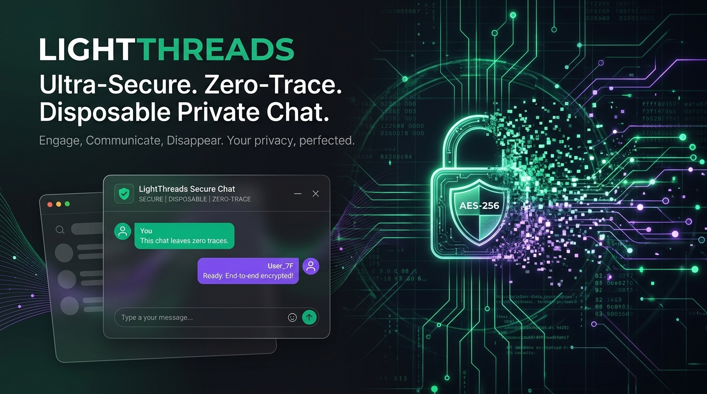
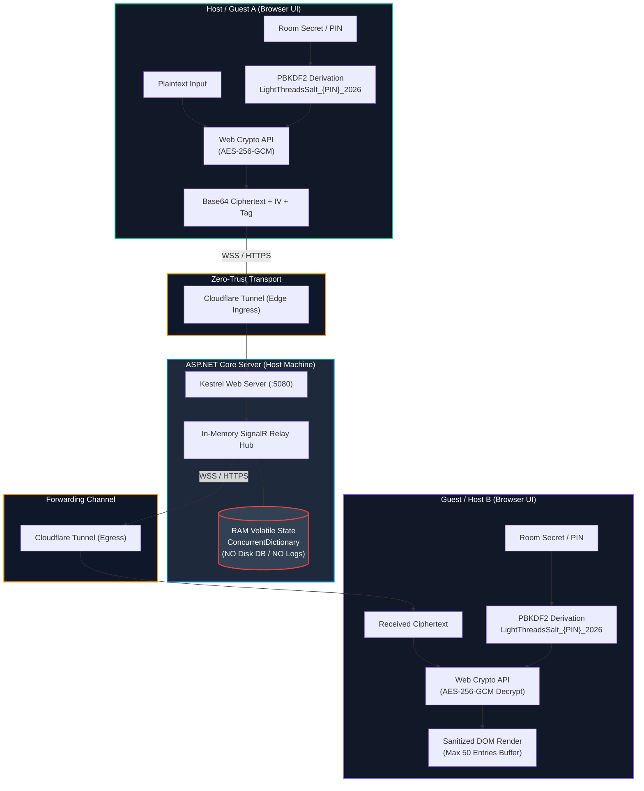
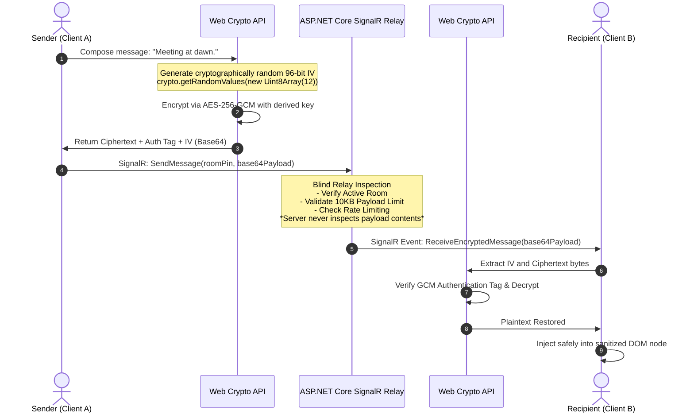
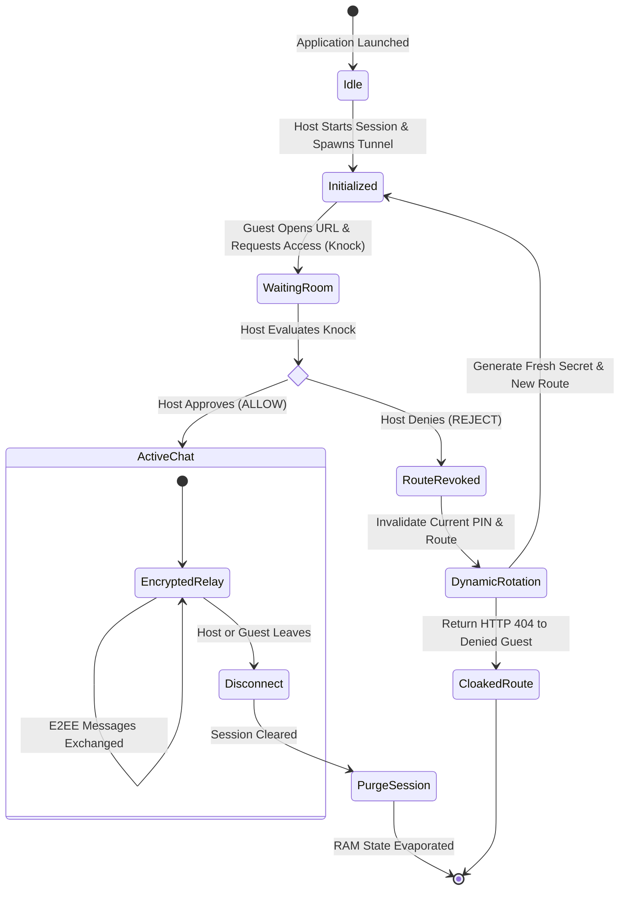
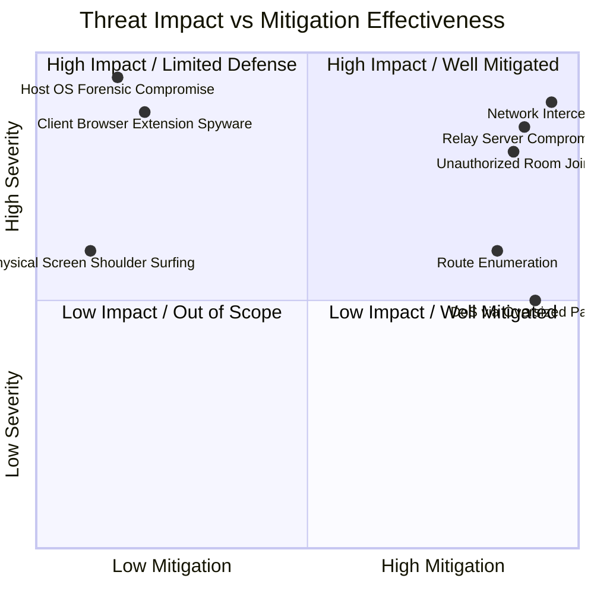
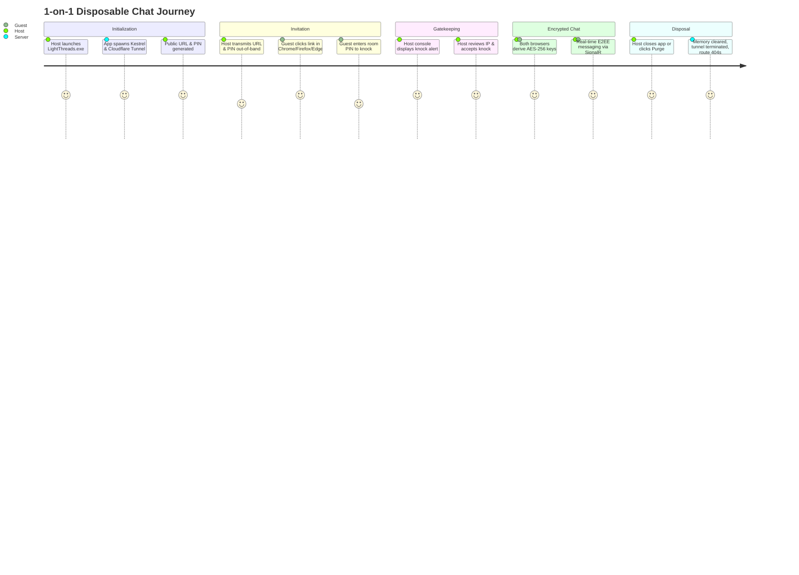

<div align="center">



# LightThreads
### Ultra-Secure • Zero-Trace • Ephemeral 1-on-1 Private Messaging Engine

[](https://dotnet.microsoft.com/)
[](https://microsoft.com)
[](#cryptographic-architecture)
[](#real-time-relay-architecture)
[](#automated-public-access-cloudflare-tunnel)
[](LICENSE)

<p align="center">
  <b>Communicate privately. Leave no digital footprints. Disappear when you close the window.</b><br>
  <i>LightThreads transforms your workstation into a temporary, zero-knowledge, encrypted communication hub with zero client installation for guests.</i>
</p>

[Quick Start](#-quick-start) • [Architecture](#-architecture--data-flow) • [Security & Cryptography](#-security--cryptographic-deep-dive) • [Session Lifecycle](#-session-lifecycle--knock-protocol) • [Threat Model](#-threat-model--mitigations) • [Contributing](#-contributing)

---

</div>

## ?? Executive Summary

**LightThreads** is an ultra-lightweight, zero-trace, disposable 1-on-1 communication system. It allows a host on Windows to spin up a private chat room on demand, expose it via an automated Cloudflare HTTPS tunnel, and securely invite a remote guest through an ephemeral link—without forcing the guest to install any client software, register an account, or reveal personal metadata.

Traditional messaging apps (Signal, Telegram, WhatsApp) require phone numbers, exchange client certificates, and persist conversation databases to disk. Web chats often log communication payloads on centralized database servers. **LightThreads operates on the inverse paradigm:**

1. **Client-Side End-to-End Cryptography:** Messages are encrypted and decrypted strictly inside browser memory using the Web Crypto API (`AES-256-GCM` + `PBKDF2`).
2. **Blind SignalR Relay:** The local ASP.NET Core server acts solely as a real-time blind packet forwarder. It never sees plaintext, never derives encryption keys, and holds no decryption material.
3. **Pure In-Memory Volatility:** Active rooms, tokens, and routing vectors exist solely in volatile RAM (`ConcurrentDictionary`). Terminating the process or resetting the room destroys all session states instantaneously.
4. **Cloaked Route Protection:** Revoked or invalid invitation routes return generic `HTTP 404 Not Found` responses, eliminating timing vectors and route probing.
5. **Zero Host Router Configuration:** Integrated Cloudflare Tunnel (`cloudflared`) creates an ephemeral public HTTPS ingress without port-forwarding, static IPs, or firewall punching.

---

## ??? Architecture & Data Flow

LightThreads utilizes a **Blind Relay Topology**. Plaintext message content never traverses any network interface or server memory in unencrypted form.



### End-to-End Cryptographic Sequence

The sequence diagram below illustrates the exact lifecycle of an individual message transmission:



---

## ?? Session Lifecycle & Knock Protocol

LightThreads enforces a strict **Host-Gated Authorization Model**. Guests cannot enter a chat room simply by obtaining an active URL; they must knock, enter a virtual waiting room, and receive explicit host approval.



### The Rejection & Route Cloaking Mechanism

When a host denies an incoming guest knock:
1. **Instant Token Revocation:** The active room PIN and associated session tokens are purged from `ConcurrentDictionary`.
2. **Route Cloaking (`HTTP 404`):** Any further requests to that URL return a standard `404 Not Found` instead of an informative `401 Unauthorized` or `403 Forbidden`. This conceals whether the route ever existed.
3. **Dynamic Route Rotation:** A brand new, cryptographically random invitation route is generated automatically for the host to distribute to trusted parties.

---

## ? Features & Capabilities

| Feature Category | Implementation | Technical Advantage |
|---|---|---|
| **End-to-End Encryption** | `AES-256-GCM` via Web Crypto API | Authenticated encryption prevents tampering and eavesdropping. |
| **Key Derivation** | `PBKDF2` (SHA-256, 100,000 iterations) | Derives 256-bit key from room secret and salt `LightThreadsSalt_{PIN}_2026`. |
| **Zero Message Persistence** | In-memory relay; zero database hooks | Plaintext and ciphertext are never logged or committed to disk. |
| **Volatile State Store** | `ConcurrentDictionary<string, RoomSession>` | High-concurrency, thread-safe memory storage erased upon termination. |
| **Automated Tunneling** | Managed `cloudflared` Child Process | Auto-provisions HTTPS tunnel without firewall rules or UPnP holes. |
| **Knock & Gatekeeping** | Host Authorization Waiting Room | Host verifies client fingerprint/IP before granting access. |
| **Anti-Recon Cloaking** | Synthetic HTTP 404 on revoked routes | Prevents malicious crawlers from detecting valid vs. invalid chat endpoints. |
| **Payload Guardrails** | SignalR Message Limit: **10 KB** | Prevents buffer exhaustion attacks and oversized file transmissions. |
| **Rate Throttling** | ASP.NET Core RateLimiter (15 req/min/IP) | Thwarts brute-force guessing and automated denial-of-service attempts. |
| **Memory-Limited DOM** | Circular ring buffer of **50 messages** | Browser interface limits scrollback to prevent DOM-based memory leaks. |
| **Hardened CSP** | Strict Content Security Policy | Disallows `unsafe-eval`, external scripts, object embeds, and clickjacking. |
| **Origin IP Extraction** | Cloudflare `CF-Connecting-IP` Parsing | Validates originating client IP when behind Cloudflare proxy edge. |

---

## ?? Cryptographic & Security Deep-Dive

### 1. Key Derivation Function (KDF)
The encryption key is deterministically generated inside the browser and **never** shared across the network:
```text
Key = PBKDF2(
    Password   = RoomSecret / PIN,
    Salt       = "LightThreadsSalt_" + RoomPIN + "_2026",
    Iterations = 100,000,
    Hash       = SHA-256,
    KeyLength  = 256 bits
)
```

> [!IMPORTANT]
> The room PIN serves as an ephemeral routing token. For high-security requirements, pair the invitation URL with an out-of-band shared passphrase of high entropy.

### 2. Authenticated Encryption with Associated Data (AEAD)
- **Algorithm:** `AES-GCM` (Galois/Counter Mode).
- **Key Size:** 256 bits.
- **Nonce / IV:** 96 bits (12 bytes) uniquely generated per message via `crypto.getRandomValues()`.
- **Authentication Tag:** 128 bits appended to ciphertext. Any bit-flipping on the transit relay results in immediate decryption rejection.

### 3. Nonce Uniqueness Guarantee
```javascript
// Browser Cryptographic Nonce Generation
const iv = window.crypto.getRandomValues(new Uint8Array(12));
const ciphertextWithTag = await window.crypto.subtle.encrypt(
    { name: "AES-GCM", iv: iv },
    derivedKey,
    encodedPlaintext
);
```
Under AES-GCM, reusing an IV with the same key destroys cryptographic confidentiality. LightThreads guarantees a fresh 96-bit cryptographically secure pseudorandom IV for every individual message.

---

## ??? Threat Model & Mitigations

LightThreads is engineered for high-assurance, disposable communications under specific operational assumptions:



### Threat Analysis Matrix

| Threat Actor / Vector | Risk | Mitigation Strategy | Boundary / Limitations |
|---|---|---|---|
| **Passive Network Sniffer (ISP, Wi-Fi)** | Critical | Cloudflare HTTPS transport + AES-256-GCM browser encryption. | Cannot protect against metadata (timing/size analysis). |
| **Compromised Server / Relay Operator** | High | Zero-Knowledge Architecture. Server only sees Base64 encrypted blobs. | If server JavaScript code is modified, keys could be captured. |
| **Uninvited Guest Infiltration** | High | Knock & approval gatekeeping + PIN validation. | Host must verify identity before clicking Approve. |
| **Brute-Force Route Guessing** | Medium | 15 req/min IP throttling + Cloaked `HTTP 404` responses. | Distributed botnets may require Cloudflare WAF rules. |
| **Malicious XSS Injection in Chat** | High | Strict DOM node assignment (`textContent`), strict Content Security Policy. | Browser zero-day exploits outside application scope. |
| **Payload Flooding / Server Crash** | Medium | SignalR hub enforces hard 10 KB maximum message buffer. | Network layer DoS requires upstream Cloudflare filtering. |
| **Forensic Memory Extraction** | Medium | In-memory only state (`ConcurrentDictionary`). No disk writes. | Host swapfile or OS RAM dump can contain residual data. |

> [!WARNING]
> **Forensic Trace Reality:** While LightThreads does not write chat history to disk or databases, host operating systems may write memory pages to pagefile/swap. Cloudflare retains connection metadata pursuant to its service policies. For absolute anonymity, host sessions should run within ephemeral live-boot environments (e.g., Tails OS or Windows Sandbox).

---

## ?? Quick Start

### Option A: Portable Windows Binary (No SDK Required)

Recommended for quick deployment and non-developer hosts.

1. **Download:** Grab the latest `LightThreadsApplication.zip` from [Releases](https://github.com/your-username/LightThreads/releases).
2. **Extract:** Extract the ZIP archive to any directory on Windows.
3. **Execute:** Run `LightThreads.exe`.
4. **Initialize:** The application automatically spins up Kestrel on `http://localhost:5080` and attaches `cloudflared`.
5. **Share:** Copy the public HTTPS invitation link and secret PIN provided in the console UI.
6. **Authorize:** When your guest visits the link, a knock notification will appear in your console/dashboard. Click **Approve**.

```powershell
# Quick Run Verification (PowerShell)
cd LightThreadsApplication
.\LightThreads.exe
```

---

### Option B: Build from Source

#### Prerequisites
- [.NET 8.0 or 9.0 SDK](https://dotnet.microsoft.com/download)
- Git
- Windows 10/11 or Windows Server
- [Cloudflare Tunnel CLI (`cloudflared`)](https://developers.cloudflare.com/cloudflare-one/connections/connect-networks/downloads/) (Optional: can be auto-downloaded)

#### 1. Clone the Repository
```bash
git clone https://github.com/your-username/LightThreads.git
cd LightThreads
```

#### 2. Restore Dependencies
```bash
dotnet restore
```

#### 3. Run Development Server
```bash
dotnet run --configuration Release
```
By default, the server binds to `http://localhost:5080` and activates the automated tunnel daemon.

---

## ?? Operational Walkthrough



---

## ?? Configuration & Environment

Configuration parameters are managed via `appsettings.json` or Environment Variables:

```json
{
  "ServerConfig": {
    "Port": 5080,
    "EnableHttpsRedirection": true
  },
  "Security": {
    "RateLimitPerMinute": 15,
    "MaxMessageSizeBytes": 10240,
    "SessionInactivityTimeoutMinutes": 30,
    "MaxChatHistoryInDom": 50
  },
  "Cloudflare": {
    "AutoStartTunnel": true,
    "BinaryPath": "tools/cloudflared.exe"
  }
}
```

| Environment Variable | Default Value | Description |
|---|---|---|
| `LIGHTTHREADS_PORT` | `5080` | Local port for Kestrel web server. |
| `LIGHTTHREADS_RATE_LIMIT` | `15` | Maximum HTTP requests per minute per IP address. |
| `LIGHTTHREADS_MAX_PAYLOAD` | `10240` | SignalR max message payload size in bytes (10 KB). |
| `LIGHTTHREADS_TUNNEL_ENABLED` | `true` | Enables or disables automated `cloudflared` provisioning. |

---

## ?? Technology Stack Breakdown

<div align="center">

| Tier | Component | Technology | Rationale |
|---|---|---|---|
| **Runtime & Host** | Web Server | ASP.NET Core 8 / 9 Minimal APIs | Ultra-fast execution, low memory overhead (<30MB RAM footprint). |
| **Real-Time** | Relay Hub | ASP.NET Core SignalR | High-speed bidirectional WebSocket communication with automatic fallback. |
| **Cryptographic Core** | Client Encryption | Web Crypto API (`SubtleCrypto`) | Native browser hardware-accelerated encryption; zero external npm packages. |
| **Edge Ingress** | Zero-Trust Proxy | Cloudflare Quick Tunnels | Instant TLS termination and zero-configuration NAT traversal. |
| **Front-End UI** | Browser Client | Modern HTML5, Vanilla CSS & ES6 JS | Zero build step, instant cold-load, strict Content Security Policy compliant. |

</div>

---

## ?? Contributing

We welcome security audits, code enhancements, and community contributions!

1. **Fork the Repository**
2. **Create a Feature Branch:** `git checkout -b feature/hardened-key-exchange`
3. **Commit Your Changes:** `git commit -m "feat: implement ephemeral ECDH key agreement"`
4. **Push to Branch:** `git push origin feature/hardened-key-exchange`
5. **Open a Pull Request**

> [!CAUTION]
> **Responsible Security Vulnerability Disclosure:**
> If you discover a cryptographic vulnerability or remote code execution flaw, **do not open a public issue**. Please report it privately to the maintainers at `security@lightthreads.local` (or via GitHub Private Vulnerability Reporting).

---

## ?? License

LightThreads is open-source software licensed under the **[MIT License](LICENSE)**.

```text
Copyright (c) 2026 LightThreads Contributors

Permission is hereby granted, free of charge, to any person obtaining a copy
of this software and associated documentation files (the "Software"), to deal
in the Software without restriction, including without limitation the rights
to use, copy, modify, merge, publish, distribute, sublicense, and/or sell
copies of the Software, and to permit persons to whom the Software is
furnished to do so, subject to the following conditions:
...
```

<div align="center">
<sub>Engineered with precision for zero-trace privacy. Built with ASP.NET Core & Web Crypto API.</sub>
</div>
